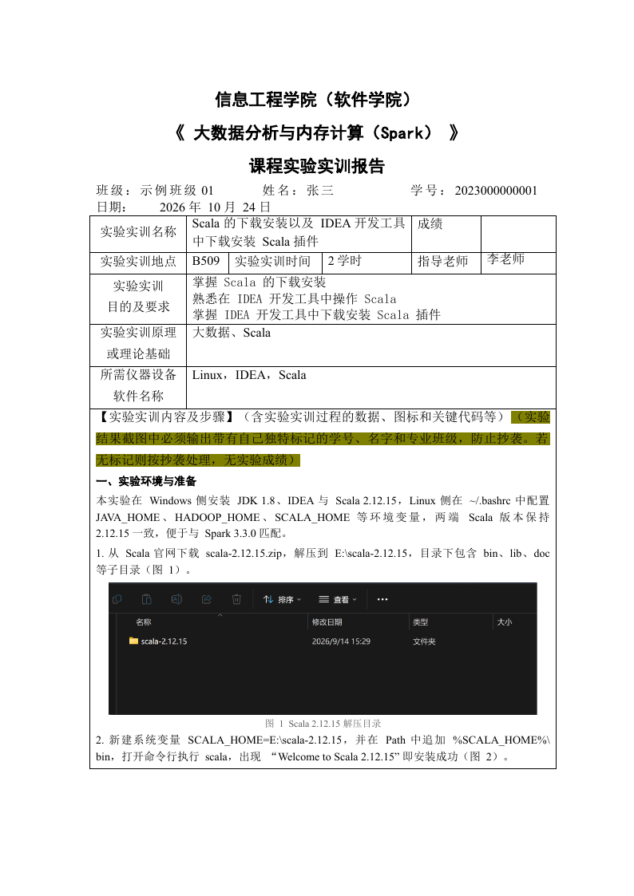

# dsh-office

[](https://github.com/Ying-Kong/dsh-office/actions/workflows/ci.yml)
[](LICENSE)
[](python/pyproject.toml)
[](node/package.json)

**Bring your own template. Fill it once. Prove it landed.**

A DSH plugin (Node) plus a deterministic Python core for filling office documents
that a human authored — faculty report forms, lab sheets, grade tables — without
letting a language model touch the XML.

> Status: **0.1.0, alpha.** Word (`.docx`) is implemented; Excel is scaffolded
> but not shipped. PowerPoint is explicitly out of scope.

---

## Why this exists

Asking a model to "fill in this report" means asking a token sampler to emit a
document tree. One bad token and the file is corrupt; one changed layout and the
numbers look right while the fonts are wrong.

dsh-office splits the job so each side does what it is good at:

| Layer | Who | Property |
|---|---|---|
| Read the template tree into facts | **code** | deterministic, diffable |
| Decide *what* to write | **model** | writes ops, not code |
| Mutate the document | **code** | closed op set, replayable |
| Decide whether it worked | **code** | hard/soft findings, exit codes |

```
   template.docx ──extract──▶ facts.json   (slots, fonts, tables, ids)
        │                         │
        │                    model authors
        │                         ▼
        │                     ops.json      (declarative, no scripts)
        ▼                         │
        └────────fill─────────────┘
                   │
                   ▼
             rendered.docx ──verify──▶ report.json  { ok, hard[], soft[] }
```



The model never writes XML, never computes page numbers, never guesses a cell.
It writes `{"op":"set_text","target":{"by":"cell-label","label":"指导老师"},"value":"李老师"}`.

---

## What it does today

- **Extract** — walks the body in document order and emits a fact table:
  paragraphs with *resolved* font size and fonts (direct run → character style
  → paragraph style → base style → document defaults), tables with stable cell
  ids, inline images, page geometry, and auto-detected fill slots:
  - empty cell to the right of a short label (the report-form pattern)
  - an inline `日期：__年__月__日` line
  - explicit `___` blanks
- **Fill** — replays a validated op list onto a copy of the template:
  - `set_text`, `replace_in_paragraph`, `set_format`
  - `append_content` with `paragraph` / `heading` / `figure` items
  - figures get a running `图 {n}` caption, are width-capped, and keep the
    caption attached to the image
  - template fingerprint guard: ops authored for a different build are refused
  - placeholder blank paragraphs a template uses to reserve row height are
    trimmed before appending, so content does not start below a gap
- **Verify** — re-reads the output and re-checks every op, plus document-wide
  invariants: font whitelist, sequential figure numbering, no leftover
  `{{placeholders}}`, image width limits, caption presence. Findings are split:
  - **hard** — must be fixed (slot value wrong, font outside whitelist,
    caption numbering gap, image too wide)
  - **soft** — reported, never looped on (platform default fonts, width within
    limits)

Verified invariants from this repo's own fixture: 2 figures, captions `[1, 2]`,
25 Python tests, 10 Node tests. The fixture is anonymised (name `张三`, id
`2023000000001`) and ships **unwatermarked** screenshots - including a
2524×1136 frame that exercises the width cap.

---

## Install

### Python core

```bash
cd python
python3 -m venv ../.venv          # or any interpreter you like
../.venv/bin/pip install -e ".[dev]"
```

Requires Python ≥ 3.10. Dependencies: `python-docx`, `click`, `jsonschema`.

### CLI

```bash
dsh-office extract template.docx -o facts.json
dsh-office fill    template.docx ops.json -o rendered.docx
dsh-office verify  rendered.docx ops.json
```

Exit codes are part of the contract:

| code | meaning |
|---|---|
| 0 | success |
| 2 | ops rejected (schema, unknown target reference) |
| 3 | verification found hard errors |
| 4 | template fingerprint mismatch |
| 5 | locator did not resolve |

### DSH plugin

```bash
dsh plugin --profile web add @dsh-office/plugin   # or link the local folder
```

The adapter registers three model-facing tools — `office_extract`,
`office_fill`, `office_verify` — and nothing else. It resolves the Python core
through, in order:

1. `config.pythonPath`
2. `$DSH_OFFICE_PYTHON`
3. `<repo>/.venv/bin/python` (or `Scripts/python.exe` on Windows)
4. `python3`

---

## Ops format

`ops.json` is data. There is no scripting op, by design.

```json
{
  "schema": "dsh-office/ops@1",
  "template": { "content_sha256": "1af5…" },
  "figure_start": 1,
  "ops": [
    { "op": "set_text",
      "target": { "by": "cell-label", "label": "指导老师" },
      "value": "李老师" },

    { "op": "replace_in_paragraph",
      "target": { "by": "paragraph-id", "id": "p2" },
      "find": "2025年  月  日", "replace": "2026 年 10 月 24 日" },

    { "op": "append_content",
      "into": { "by": "cell-id", "id": "t0r5c0" },
      "items": [
        { "kind": "heading", "text": "一、实验环境与准备" },
        { "kind": "paragraph", "text": "…" },
        { "kind": "figure", "image": "../images/fig1.png",
          "caption": "图 {n}  Scala 2.12.15 解压目录", "width_cm_max": 14.2 }
      ] }
  ]
}
```

Locators, in order of preference:

| locator | example | breaks when |
|---|---|---|
| `cell-label` | the cell to the right of `指导老师` | the label text changes |
| `paragraph-text` | first paragraph containing `日期` | the sentence changes |
| `paragraph-id` / `cell-id` | `p2`, `t0r5c0` | the template gains a paragraph/row |

Ids are assigned by walking the body in order, so they are stable for a given
template build — and the fingerprint guard turns "different build" into an
error instead of a silent misplacement.

Schemas: [`spec/ops.schema.json`](spec/ops.schema.json),
[`spec/facts.schema.json`](spec/facts.schema.json).

---

## Repository layout

```
python/office_core/     core: docx_io, index, styles, extract, ops, verify, cli
python/tests/           25 tests (extract, ops, verify, determinism, cli)
node/src/core.mjs       CLI wrapper (no document logic)
node/src/plugin.mjs     DSH adapter: 3 tools
node/test/              10 tests (core contract + plugin contract)
fixtures/               anonymised template, ops, full-size (unwatermarked) images
spec/                   the two schemas - the constitution
tools/sanitize_fixture.py  redact a contributed form before publishing it
docs/limitations.md     what this deliberately does not do
```

---

## Development

```bash
make setup     # venv + install both sides
make test      # python tests + node tests
make demo      # render fixtures/reporter into .scratch/demo.docx
make verify    # verify the rendered demo
```

All temp output stays inside this repository (`.scratch/`, `.pytest-work/`,
`.node-work-*/`). The test suite never reads or writes paths outside it.

See [CONTRIBUTING.md](CONTRIBUTING.md) for the seam table: what to add where.

---

## Non-goals

- PowerPoint, `.doc` (legacy binary), macro-enabled packages
- WYSIWYG editing, tracked changes, cross-references, TOCs
- Replacing Word's layout engine

## Known limitations

Cross-engine pagination, theme fonts, document grids, zip timestamp instability,
and the "why the whole file is not byte-identical" answer live in
[docs/limitations.md](docs/limitations.md). Read it before filing a bug.

## License

MIT. See [LICENSE](LICENSE).
